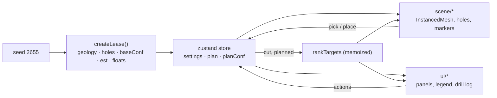

# Fe: iron ore lease viewer

Fe shows one iron ore lease, "Ridge lease R‑07", as a 3D block model of a banded iron formation.
It is a React + TypeScript port of the single-file prototype in [`prototype/fe.html`](prototype/fe.html),
which remains the reference for behaviour, visuals, copy and maths.

> **All data is synthetic and illustrative.** The geology, assays, drill holes, prices and costs
> are generated from a fixed random seed. Nothing here describes a real deposit.

## What the model answers

Fe divides the lease into a 3D grid of rock cells. For any part of the ground it answers four
questions: **is there ore, how rich is it, how sure are we, and is it worth mining or drilling next.**

Each cell carries an estimated grade (% Fe), a confidence based on how close the nearest drill hole
is, the chance it beats the cut-off grade, and an indicative margin per tonne.

## How to read it

1. **Start with Fe grade.** Deep red cells are rich hematite; grey is waste or low-grade BHQ.
   Faded cells have little drilling behind them, so treat their colour as a guess.
2. **Switch to Confidence.** Bright cells sit near drill holes. Dark ground is unknown, even if the
   grade view looks promising there.
3. **Check Chance above cut-off.** This combines grade and confidence. Cells near 50% are the
   uncertain ones where one more hole changes the picture most.
4. **Read a drill log.** Click any hole to see rock type and assays down its depth, and the best ore
   interval it cut.
5. **Move the cut-off slider.** Raising it shows how tonnage shrinks as you demand higher grade,
   which is the basic trade-off in planning a mine.
6. **Open Drill plan.** Suggested targets are where a new hole would remove the most uncertainty.
   Add a few and watch how many tonnes move to G2 or better.

### The words the model uses

| Term                 | Meaning                                                                                                                                                       |
| -------------------- | ------------------------------------------------------------------------------------------------------------------------------------------------------------- |
| Reef ore             | Hard, massive hematite that forms continuous bodies inside the iron formation.                                                                                |
| Pocket deposits      | Small, isolated lenses of rich ore. Valuable, but easy to miss between holes and hard to plan around.                                                         |
| Blue dust            | Soft, powdery, very high-grade hematite, common in Indian iron ore belts.                                                                                     |
| Lateritic ore        | Weathered, iron-rich cap near the surface with moderate grade.                                                                                                |
| Float ore            | Loose ore fragments that have broken off outcrops and rolled downslope. A surface clue to what lies upslope.                                                  |
| Core and RC drilling | Exploration methods, not ore types. Core (diamond) drilling recovers an intact cylinder of rock; reverse circulation is faster and cheaper but returns chips. |
| BHQ                  | Banded hematite quartzite, the low-grade host rock around the ore.                                                                                            |
| G1–G4                | Confidence stages in the spirit of India's UNFC geological axis, from G1 (detailed exploration) to G4 (reconnaissance).                                       |

## Modelling assumptions

Everything below is a deliberate simplification for illustration.

- **Grid.** 44 × 32 × 20 cells of 25 m × 25 m × 10 m, shown with 1.5× vertical exaggeration.
  Elevation RL = 820 m + 10 m per cell row.
- **One random stream.** A `mulberry32` generator seeded with **2655** drives everything, in a fixed
  order: the noise permutation table, the rock model, the drill-hole depths, then float ore.
- **Topography.** A sinuous ridge (`ridgeJ`) with a Gaussian cross-section plus fractal value noise.
- **Rock types.** A dipping band of iron formation follows the ridge. Inside it: a lateritic cap
  (top two cells), hematite where the noise field is high, blue dust in the richest hematite, and
  BHQ elsewhere. Outside it: waste (phyllite, shale).
- **Occurrence.** Hematite and blue dust are grouped into 6-connected bodies. Hematite in bodies of
  fewer than 70 cells is a _pocket deposit_, otherwise _reef ore_.
- **Drilling.** 14 existing holes along and beside the ridge (every third one RC, the rest core),
  140–190 m deep.
- **Confidence.** For each hole, influence decays as `exp(−d²/3.3²)` with horizontal distance in
  cells (zero beyond 7 cells) and as a Gaussian with a 2.5-cell length below the hole bottom. Holes
  combine as `1 − ∏(1 − 0.97·f)`. Surface mapping gives the top two cells of every column at least
  0.3. Confidence is capped at 0.97.
- **Estimated grade.** True grade plus a smooth error field scaled by `(1 − confidence) × 7% Fe`.
  Uncertainty is `σ = 1.5 + 11·(1 − c)` % Fe. The chance above cut-off is `Φ((est − cut)/σ)`.
- **UNFC stage.** G1 at confidence ≥ 0.75, G2 ≥ 0.5, G3 ≥ 0.25, otherwise G4.
- **Tonnes.** Cell volume × density (waste 2.6, BHQ 3.3, hematite 4.2, blue dust 3.2,
  laterite 3.0 t/m³). The resource is BHQ or richer at or above the cut-off (default 45% Fe, the
  Indian Bureau of Mines threshold for hematite ore). It is always reported on existing drilling.
- **Economics.** An indicative price curve from ₹700/t at 45% Fe to ₹6,100/t at 67% Fe, and a
  mining cost of ₹720/t plus ₹3.2/t per metre of depth.
- **Where to drill next.** Each cell is weighted by `tonnes × P(1 − P) × 4 × (0.4 + price/6100)`,
  largest where the chance of beating the cut-off is near 50%. Every column is scored by the
  confidence a planned core hole (17 cells below the top, up to 180 m) would add to weighted cells
  within 4 cells. The top 5 columns are picked greedily, at least 5 cells apart and at least 3
  cells from any existing or planned hole.

## Architecture

```
src/
├── model/             Pure TypeScript. No React or Three imports. Deterministic.
│   ├── rng.ts           mulberry32, gaussian, value noise, fbm
│   ├── grid.ts          grid constants, index helpers, world-coordinate mapping
│   ├── geology.ts       topography, rock types, grades, occurrence flood fill, float ore
│   ├── holes.ts         existing core and RC holes, planned-hole factory
│   ├── confidence.ts    computeConf: distance decay, depth falloff, surface floor
│   ├── estimate.ts      estimated grade, sigma, normal CDF, UNFC stage, tonnes, price, cost
│   ├── planning.ts      target ranking, impactOf, best intercept, column logs
│   ├── lease.ts         createLease(seed): runs the steps above in the fixed order
│   └── types.ts
├── state/
│   └── store.ts       zustand store: view settings, selection, plan, theme, camera requests;
│                      memoized target ranking
├── scene/             @react-three/fiber
│   ├── Scene.tsx        Canvas, lights, OrbitControls, animated camera presets
│   ├── CellBlocks.tsx   one InstancedMesh for every cell (setMatrixAt / setColorAt / count)
│   ├── Surface.tsx      wireframe ground surface and invisible pick mesh
│   ├── DrillHoles.tsx   core, RC and planned holes with collar rings
│   ├── FloatOre.tsx     instanced float-ore fragments
│   ├── TargetMarkers.tsx  target cones and HTML tags
│   ├── SelectionBoxes.tsx hover and pinned-cell outlines
│   ├── Picking.ts       hover, click-to-select, click-to-place
│   └── colors.ts        colour ramps and categorical palettes
├── ui/
│   ├── Header.tsx  ControlPanel.tsx  Legend.tsx  Compass.tsx
│   ├── ResourceSummary.tsx  Inspector.tsx  DrillPlanPanel.tsx
│   ├── GuidePanel.tsx  DrillLog.tsx (canvas)
├── App.tsx  main.tsx  styles.css
```



What is computed when:

| Value                                                 | Recomputed when                                                |
| ----------------------------------------------------- | -------------------------------------------------------------- |
| Geology, holes, base confidence, estimates, float ore | Once, at start-up (`getLease()`)                               |
| Plan confidence (`planConf`)                          | Planned holes are added or removed                             |
| Target ranking                                        | Cut-off or plan changes, only while the Drill plan tab is open |
| Instance matrices and colours                         | Colour mode, filters, slices, scenario or theme change         |

## Running it

Requires Node 18 or newer.

```bash
npm install
```

```bash
npm run dev
```

Opens on <http://localhost:5173>.

## Testing

```bash
npm test
```

Vitest covers RNG determinism, occurrence classification, confidence near and far from holes,
normal CDF values, the price curve, best-intercept detection, and target ranking and spacing.

`src/model/golden.test.ts` checks the port against reference values produced by running the
prototype's own model code (`npm run golden` regenerates them from `prototype/fe.html`): cell
counts, grade sums, drill holes, float ore, tonnages by stage and occurrence, the DDH-04 log, the
ranked targets at two cut-offs, and the effect of a planned hole.

```bash
npm run lint
```

## Resource report

Click **Download report (PDF)** in the header, or under *Resource above cut-off* on the Model
tab. The report uses the cut-off currently set on the slider; the PDF library loads only on the
first click.

The same report can be written from the command line:

```bash
npm run report
```

This writes `reports/Fe-resource-report.pdf`: tonnes, share, Fe grade, confidence and chance above
cut-off for each rock type; ore by occurrence; a grade-tonnage table; and the drill holes with their
best intercepts. Pass another cut-off with `npm run report -- 55`. The numbers come from
`src/model/report.ts` and the layout from `src/report/reportDocument.ts`, shared by both. Every
page is marked as synthetic.

## Building and deploying

```bash
npm run build
```

Type-checks, then writes a static site to `dist/`. `vercel.json` configures Vercel to run
`npm run build` and serve `dist/`; import the repository into Vercel with the default Vite preset.

## Changes from the prototype

Behaviour, copy and numbers follow the prototype. These deliberate fixes are the only differences:

- Highlighting a target is keyed by its column, so after re-ranking (a cut-off change, or adding
  or removing a planned hole) the highlight no longer jumps to a different target.
- Removing a planned hole clears the drill log if it was showing that hole.
- The grade legend places its ticks at their true positions on the ramp (they were evenly spaced,
  so 45 and 58 sat in the wrong place). The "% Fe" unit moved into the legend heading.
- The plan summary reports the actual metres of core. Planned holes are 180 m, or shorter where
  the base of the model cuts them off (the prototype said 170 m per hole).
- The drill log redraws once the Archivo font loads, so its labels use the right font.
- Tabs follow the WAI-ARIA tabs pattern (arrow keys, `aria-controls`); target headings are `h3`.
- The camera uses OrbitControls with the prototype's limits, so drag sensitivity differs slightly.

Added after the port:

- A hover card next to the cursor: cell index (i, j, k), depth, grade ± sigma, chance above
  cut-off and confidence bars, east/north position, cell size and tonnes, and a status badge.
  The badge splits at a 50% chance and at confidence 0.5 (the G2 boundary): *Defined ore*,
  *Speculative: needs drilling*, *Below cut-off: well tested*, or *Unknown: little data*.
  The pinned inspector shows the same status and cell size, and the legend states the cell size.
- A Download report (PDF) button.
